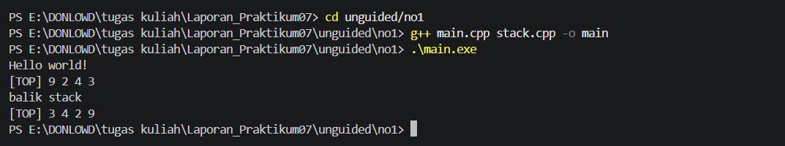
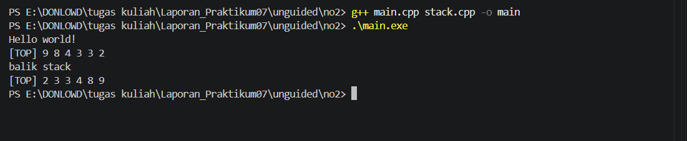
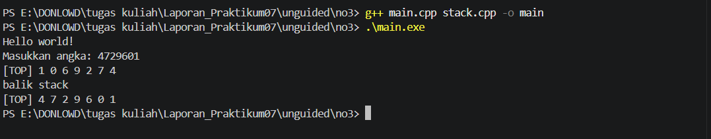

# <h1 align="center">Laporan Praktikum Modul 7 STACK  </h1>

<p align="center">Muhammad Farrel Argiyanto - 109082500018</p>

## Dasar Teori

Stack merupakan salah satu bentuk struktur data linear yang menggunakan prinsip kerja seperti tumpukan. Prinsip operasi yang digunakan adalah LIFO (Last In First Out), yaitu elemen yang terakhir dimasukkan akan menjadi elemen pertama yang dikeluarkan. Dalam struktur Stack, akses terhadap data hanya dapat dilakukan melalui bagian paling atas yang disebut `Top`. Oleh karena itu, penambahan dan pengambilan elemen dilakukan pada posisi tersebut.

Operasi utama pada Stack terdiri dari `Push` dan `Pop`. Operasi `Push` digunakan untuk menambahkan elemen baru ke dalam tumpukan. Pada implementasi menggunakan pointer, elemen baru dialokasikan terlebih dahulu, kemudian pointer `next` diarahkan ke elemen yang sebelumnya berada di posisi `Top`. Setelah itu, `Top` diperbarui agar menunjuk ke elemen yang baru ditambahkan. Sementara itu, operasi `Pop` digunakan untuk mengambil atau menghapus elemen paling atas dari Stack dengan memindahkan posisi `Top` ke elemen berikutnya.

Dalam implementasinya, Stack dapat direpresentasikan menggunakan pointer maupun tabel (array). Pada representasi pointer, struktur Stack menggunakan node yang memiliki bagian `info` untuk menyimpan data dan `next` untuk menunjuk node berikutnya. Stack memiliki pointer `Top` sebagai penanda elemen paling atas. Sementara itu, pada representasi tabel, Stack menggunakan array dengan indeks `Top` untuk menunjukkan posisi elemen teratas. Representasi tabel memiliki kapasitas maksimum sehingga jumlah elemen yang dapat disimpan terbatas.

Selain operasi `Push` dan `Pop`, Stack memiliki beberapa operasi pendukung, seperti `createStack()` untuk membuat Stack kosong, `isEmpty()` untuk memeriksa apakah Stack kosong, `alokasi()` untuk menyediakan memori bagi elemen baru, dan `dealokasi()` untuk membebaskan memori. Terdapat juga operasi `viewStack()` atau `printInfo()` untuk menampilkan seluruh elemen yang tersimpan. Operasi-operasi tersebut membantu proses pengelolaan data agar berjalan dengan terstruktur.

Pada representasi tabel, operasi `Push` dilakukan dengan menaikkan nilai `Top` kemudian memasukkan data ke indeks tersebut. Sebaliknya, operasi `Pop` dilakukan dengan mengambil data pada indeks `Top`, kemudian menurunkan nilai `Top` satu posisi. Berbeda dengan representasi pointer, penggunaan array tidak memerlukan proses alokasi dan dealokasi memori untuk setiap elemen karena kapasitas penyimpanannya telah ditentukan sebelumnya.

Melalui materi Stack, pemahaman mengenai prinsip LIFO, penggunaan pointer, pengelolaan array, serta penerapan operasi `Push` dan `Pop` dapat ditingkatkan. Struktur data Stack banyak digunakan dalam pengelolaan data yang membutuhkan proses penambahan dan pengambilan elemen berdasarkan urutan terakhir masuk dan pertama keluar.&#x20;

## Guided

### 1. Implementasi Stack

#### a. File `Stack.h`

```cpp
/* file : stack.h
   contoh ADT stack dengan representasi tabel */
#ifndef STACK_H_INCLUDED
#define STACK_H_INCLUDED

#include <iostream>
using namespace std;

struct infotype {
    char nim[20];
    char nama[20];
};
struct Stack {
    infotype info[10];
    int Top;
};

/* prototype */
/******** pengecekan apakah Stack kosong *********/
int isEmpty(Stack S);
/* mengembalikan nilai 0 jika stack kosong */

/******** pembuatan Stack ********/
void createStack(Stack &S);
/* I.S. sembarang
   F.S. terbentuk stack dengan Top=0 */

/******** penambahan elemen pada Stack ********/
void push(Stack &S, infotype X);
/* I.S. Stack mungkin kosong
   F.S. menambahkan elemen pada stack dengan nilai X, TOP=TOP+1 */

/******** penghapusan elemen pada Stack ********/
void pop(Stack &S, infotype &X);
/* I.S. stack tidak kosong
   F.S. nilai info pada indeks TOP disimpan pada X, kemudian TOP=TOP-1 */

/******** proses semua elemen Stack *********/
void viewStack(Stack S);
/* I.S. stack mungkin kosong
   F.S. jika stack tidak kosong menampilkan semua info yang ada pada stack
*/
#endif // STACK_H_INCLUDED
```

#### b. File `stack.cpp`

```cpp
#include "stack.h"

int isEmpty(Stack S) {
    /* Top = 0 berarti kosong, sesuai komentar di stack.h dikembalikan 0 */
    if (S.Top == 0) {
        return 0;
    } else {
        return 1;
    }
}

void createStack(Stack &S) {
    S.Top = 0;
}

void push(Stack &S, infotype X) {
    if (S.Top < 10) {
        S.Top = S.Top + 1;
        S.info[S.Top - 1] = X;   /* Top 1..10 dipetakan ke indeks array 0..9 */
    } else {
        cout << "Stack penuh, data tidak bisa ditambahkan" << endl;
    }
}

void pop(Stack &S, infotype &X) {
    if (isEmpty(S) != 0) {
        X = S.info[S.Top - 1];
        S.Top = S.Top - 1;
    } else {
        cout << "Stack kosong, tidak ada data yang bisa diambil" << endl;
    }
}

void viewStack(Stack S) {
    if (isEmpty(S) == 0) {
        cout << "Stack kosong" << endl;
    } else {
        cout << "Isi stack (dari TOP):" << endl;
        for (int i = S.Top; i >= 1; i--) {
            cout << i << ". " << S.info[i - 1].nim << " - "
                 << S.info[i - 1].nama << endl;
        }
    }
}

```
#### c. File `main.cpp`

```cpp
#include <iostream>
#include <cstring>
#include "stack.h"
using namespace std;

int main() {
    Stack S;
    infotype data, hasil;

    createStack(S);
    cout << "Stack baru dibuat, Top = " << S.Top << endl;
    viewStack(S);

    cout << endl << "--- Push 3 data ---" << endl;
    strcpy(data.nim, "103112400001");
    strcpy(data.nama, "Andi");
    push(S, data);

    strcpy(data.nim, "103112400002");
    strcpy(data.nama, "Budi");
    push(S, data);

    strcpy(data.nim, "103112400003");
    strcpy(data.nama, "Citra");
    push(S, data);
    viewStack(S);

    cout << endl << "--- Pop 1 data ---" << endl;
    pop(S, hasil);
    cout << "Data yang diambil: " << hasil.nim << " - " << hasil.nama << endl;
    viewStack(S);

    cout << endl << "--- Pop sampai kosong ---" << endl;
    pop(S, hasil);
    pop(S, hasil);
    pop(S, hasil);
    viewStack(S);

    return 0;
}
```

### 2. Penjelasan Program

Program ini mengimplementasikan Stack menggunakan representasi tabel (array) untuk menyimpan data mahasiswa yang terdiri dari NIM dan nama. Pada file Stack.h, didefinisikan struktur infotype untuk menyimpan informasi mahasiswa dan struktur Stack yang memiliki array info serta variabel Top sebagai penanda posisi elemen paling atas. File stack.cpp berisi implementasi fungsi isEmpty() untuk memeriksa kondisi Stack, createStack() untuk membuat Stack kosong, push() untuk menambahkan data, pop() untuk mengambil elemen paling atas, dan viewStack() untuk menampilkan seluruh isi Stack. Sementara itu, file main.cpp digunakan untuk menguji operasi Stack dengan menambahkan tiga data mahasiswa, mengambil satu data menggunakan pop(), kemudian melakukan beberapa kali pengambilan hingga Stack kosong. Melalui program ini, penerapan prinsip LIFO (Last In First Out) dapat diamati, yaitu data yang terakhir dimasukkan akan menjadi data pertama yang diambil.

## Unguided

## 1. ADT Stack Menggunakan Array

Pada soal pertama, dibuat ADT Stack menggunakan array dengan kapasitas 20 elemen bertipe integer. Operasi yang digunakan meliputi `createStack()`, `push()`, `pop()`, `printInfo()`, dan `balikStack()`.

### a. File `stack.h`

```cpp
#ifndef STACK_H
#define STACK_H

#define MAX 20

typedef int infotype;

struct Stack {
    infotype info[MAX];
    int Top;
};

void createStack(Stack &S);
int isEmpty(Stack S);
void push(Stack &S, infotype x);
infotype pop(Stack &S);
void printInfo(Stack S);
void balikStack(Stack &S);

#endif
```

### b. File `stack.cpp`

```cpp
#include <iostream>
#include "stack.h"
using namespace std;

void createStack(Stack &S) {
    S.Top = 0;
}

int isEmpty(Stack S) {
    return S.Top == 0;
}

void push(Stack &S, infotype x) {
    if (S.Top < MAX) {
        S.info[S.Top] = x;
        S.Top++;
    } else {
        cout << "Stack penuh." << endl;
    }
}

infotype pop(Stack &S) {
    if (!isEmpty(S)) {
        S.Top--;
        return S.info[S.Top];
    }

    cout << "Stack kosong." << endl;
    return -1;
}

void printInfo(Stack S) {
    if (isEmpty(S)) {
        cout << "Stack kosong." << endl;
        return;
    }

    cout << "[TOP] ";
    for (int i = S.Top - 1; i >= 0; i--) {
        cout << S.info[i] << " ";
    }
    cout << endl;
}

void balikStack(Stack &S) {
    int kiri = 0;
    int kanan = S.Top - 1;

    while (kiri < kanan) {
        infotype temp = S.info[kiri];
        S.info[kiri] = S.info[kanan];
        S.info[kanan] = temp;

        kiri++;
        kanan--;
    }
}
```

### c. File `main.cpp`

```cpp
#include <iostream>
#include "stack.h"
using namespace std;

int main() {
    Stack S;

    createStack(S);

    cout << "Hello world!" << endl;

    push(S, 3);
    push(S, 4);
    push(S, 8);

    pop(S);

    push(S, 2);
    push(S, 3);

    pop(S);

    push(S, 9);

    printInfo(S);

    cout << "balik stack" << endl;
    balikStack(S);
    printInfo(S);

    return 0;
}
```

### d. Contoh Output

```text
Hello world!
[TOP] 9 2 4 3
balik stack
[TOP] 3 4 2 9
```

### Output Unguided 1

#### Output 1



Program ini mengimplementasikan struktur data Stack menggunakan representasi tabel (array) dengan kapasitas maksimum 20 elemen dan tipe data integer. Pada file stack.h, didefinisikan struktur Stack yang memiliki array info untuk menyimpan data dan variabel Top sebagai penanda posisi elemen paling atas. File stack.cpp berisi implementasi fungsi createStack() untuk membuat Stack kosong, isEmpty() untuk memeriksa kondisi Stack, push() untuk menambahkan elemen, pop() untuk mengambil elemen paling atas, printInfo() untuk menampilkan seluruh isi Stack, dan balikStack() untuk membalik urutan elemen. Sementara itu, file main.cpp digunakan untuk menguji operasi Stack dengan memasukkan beberapa angka, melakukan pengambilan elemen menggunakan pop(), menampilkan isi Stack, dan membalik urutannya. Melalui program ini, penerapan prinsip LIFO (Last In First Out) dapat diamati, yaitu elemen yang terakhir dimasukkan akan menjadi elemen pertama yang diambil.

## 2. Prosedur `pushAscending()`

Pada soal kedua, ditambahkan prosedur `pushAscending()` untuk memasukkan elemen ke dalam Stack secara terurut. Elemen disusun dari nilai terkecil hingga terbesar pada array, sehingga ketika ditampilkan dari posisi TOP, urutannya terlihat dari nilai terbesar ke terkecil.

### a. Tambahkan deklarasi pada `stack.h`

```cpp
void pushAscending(Stack &S, infotype x);
```

### b. Tambahkan implementasi pada `stack.cpp`

```cpp
void pushAscending(Stack &S, infotype x) {
    if (S.Top >= MAX) {
        cout << "Stack penuh." << endl;
        return;
    }

    int i = S.Top;

    while (i > 0 && S.info[i - 1] > x) {
        S.info[i] = S.info[i - 1];
        i--;
    }

    S.info[i] = x;
    S.Top++;
}
```

### c. File `main.cpp`

```cpp
#include <iostream>
#include "stack.h"
using namespace std;

int main() {
    Stack S;

    createStack(S);

    cout << "Hello world!" << endl;

    pushAscending(S, 3);
    pushAscending(S, 4);
    pushAscending(S, 8);
    pushAscending(S, 2);
    pushAscending(S, 3);
    pushAscending(S, 9);

    printInfo(S);

    cout << "balik stack" << endl;
    balikStack(S);
    printInfo(S);

    return 0;
}
```

### d. Contoh Output

```text
Hello world!
[TOP] 9 8 4 3 3 2
balik stack
[TOP] 2 3 3 4 8 9
```

### Output Unguided 2

#### Output 2



Program ini merupakan pengembangan dari ADT Stack pada nomor 1 dengan menambahkan prosedur pushAscending() untuk memasukkan elemen secara terurut berdasarkan nilai terkecil hingga terbesar. Pada file stack.h, ditambahkan deklarasi fungsi pushAscending(), sedangkan implementasinya terdapat pada file stack.cpp. Prosedur tersebut bekerja dengan membandingkan nilai yang akan dimasukkan dengan elemen yang sudah tersimpan di dalam array. Jika terdapat elemen yang lebih besar, posisi elemen tersebut digeser untuk memberikan tempat bagi data baru. Pada file main.cpp, dilakukan pengujian dengan memasukkan angka 3, 4, 8, 2, 3, dan 9. Hasilnya, data tersimpan secara berurutan dari nilai terkecil hingga terbesar pada array, sehingga ketika ditampilkan dari posisi TOP menghasilkan urutan 9 8 4 3 3 2. Selanjutnya, prosedur balikStack() digunakan untuk membalik urutan elemen sehingga tampilannya menjadi 2 3 3 4 8 9.

## 3. Prosedur `getInputStream()`

Pada soal ketiga, ditambahkan prosedur `getInputStream()` untuk membaca input dari pengguna secara terus-menerus hingga tombol Enter ditekan. Setiap karakter angka yang dimasukkan diubah menjadi integer dan disimpan ke dalam Stack menggunakan operasi `push()`.

### a. Tambahkan deklarasi pada `stack.h`

```cpp
void getInputStream(Stack &S);
```

### b. Tambahkan implementasi pada `stack.cpp`

```cpp
void getInputStream(Stack &S) {
    char input;

    cout << "Masukkan angka: ";

    while (cin.get(input) && input != '\n') {
        if (input >= '0' && input <= '9') {
            push(S, input - '0');
        }
    }
}
```

### c. File `main.cpp`

```cpp
#include <iostream>
#include "stack.h"
using namespace std;

int main() {
    Stack S;

    createStack(S);

    cout << "Hello world!" << endl;

    getInputStream(S);

    printInfo(S);

    cout << "balik stack" << endl;
    balikStack(S);
    printInfo(S);

    return 0;
}
```

### d. Contoh Output

```text
Hello world!
Masukkan angka: 4729601
[TOP] 1 0 6 9 2 7 4
balik stack
[TOP] 4 7 2 9 6 0 1
```

### Output Unguided 3

#### Output 3



Program ini mengembangkan ADT Stack dengan menambahkan prosedur getInputStream() untuk menerima input dari pengguna secara berulang hingga tombol Enter ditekan. Pada file stack.h, ditambahkan deklarasi fungsi getInputStream(), sedangkan implementasinya terdapat pada file stack.cpp. Prosedur tersebut menggunakan cin.get() untuk membaca setiap karakter yang dimasukkan pengguna. Karakter yang berupa angka kemudian dikonversi menjadi tipe integer dan dimasukkan ke dalam Stack menggunakan fungsi push(). Pada file main.cpp, prosedur getInputStream() dipanggil setelah Stack dibuat menggunakan createStack(). Selanjutnya, fungsi printInfo() digunakan untuk menampilkan seluruh data yang telah dimasukkan, kemudian balikStack() digunakan untuk membalik urutan elemen. Melalui program ini, pengguna dapat memasukkan beberapa angka sekaligus dan melihat penerapan prinsip LIFO pada proses penyimpanan serta penampilan data dalam Stack.

## Kesimpulan

Berdasarkan praktikum Modul 7 tentang Stack, dapat disimpulkan bahwa Stack merupakan struktur data linear yang menggunakan prinsip LIFO (Last In First Out), yaitu elemen yang terakhir dimasukkan akan menjadi elemen pertama yang dikeluarkan. Pada praktikum ini, Stack diimplementasikan menggunakan representasi tabel (array) dengan kapasitas maksimum 20 elemen. Operasi yang dipelajari meliputi createStack() untuk membuat Stack kosong, isEmpty() untuk memeriksa kondisi Stack, push() untuk menambahkan elemen, pop() untuk mengambil elemen teratas, printInfo() untuk menampilkan isi Stack, dan balikStack() untuk membalik urutan elemen. Pada tugas nomor 1, dilakukan pengujian operasi penambahan, pengambilan, dan pembalikan data Stack. Pada tugas nomor 2, ditambahkan prosedur pushAscending() untuk memasukkan elemen secara terurut berdasarkan nilai terkecil hingga terbesar. Sementara itu, pada tugas nomor 3, ditambahkan prosedur getInputStream() untuk menerima input angka dari pengguna hingga tombol Enter ditekan, kemudian menyimpannya ke dalam Stack. Melalui seluruh rangkaian praktikum dan tugas tersebut, pemahaman mengenai prinsip LIFO, penggunaan array, pengelolaan indeks Top, serta penerapan operasi penambahan, pengambilan, pengurutan, dan pembalikan elemen pada struktur data Stack dapat ditingkatkan.


## Referensi

[1] Tim Praktikum Struktur Data. (t.t.). Modul 7: Stack. Modul Praktikum Struktur Data, hlm. 59–65.

[2] Morin, P. (2013). Open Data Structures: An Introduction. Athabasca University Press. https://opendatastructures.org/ 
Athabasca University.

[3] Weiss, M. A. (2013). Data Structures and Algorithm Analysis in C++ (4th ed.). Pearson.
